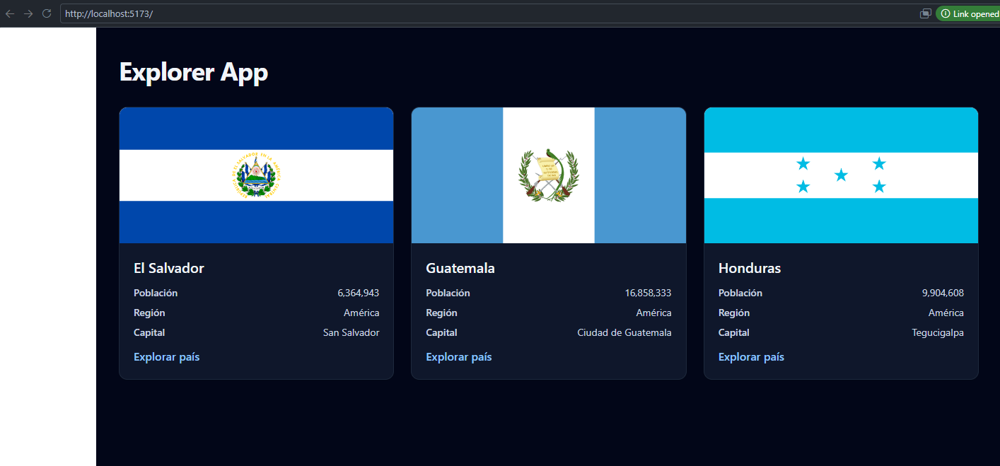

# explorer-react
# Actividad s24
# Explorer App (React Migration) 

Migración de la interfaz de la Explorer App hacia una arquitectura basada en componentes utilizando React y Vite. En esta fase inicial, se transformó la tarjeta de país en un componente funcional con props fuertemente tipadas y se implementó una cuadrícula responsiva con datos locales.

## Tecnologías Utilizadas
* **Framework:** React 18
* **Herramienta de construcción:** Vite
* **Lenguaje:** TypeScript
* **Estilos:** Tailwind CSS v4
* **Gestor de paquetes:** pnpm

## Requisitos Previos
* Node.js v22.12 o superior.
* pnpm instalado globalmente.

## Instalación y Ejecución

1. Clonar el repositorio y acceder a la carpeta:
   
   git clone https://github.com/XavierWrx/explorer-react.git
   cd explorer-react

   1. Instalar las Dependencias.
        pnpm install
   2. Iniciar el servidor de desarrollo
        pnpm run dev
   3. Compilar para produccion.
        pnpm run build

        

1. ¿Qué cambió al pasar de renderCountryCard a CountryCard.tsx?
Al pasar de Vanilla TS a React, ya no contruimos manualmente  string de html, en su lugar , CountryCard.tsx es un componente 
funcional que devuelve JSX estructurado.

2. ¿Qué recibe tu componente mediante props y cómo está tipado?
   recibe un objeto que representa los datos del paies, por medio de Country.
   utilzamos typescript `` interface CountryCardsProps { contryu : Country ; }`` lo que garantiza que no se utilice el tipo
   any y que el componente siempre reciba la estructura de datos correcta.
   
3. ¿Qué tipo o utilidad reutilizaste y por qué?
   src/types/country.ts
   la funcion formatPopulation de src/utils/format.ts 
   ambar son partes de codigo que son ajenas al DOM y tiene la Logica del explorer app.

4. ¿Qué comprobaste con los tres países y qué pendiente debes resolver?
   Al pasar los tres países estáticos locales (paisUno, paisDos, paisTres) como props en App.tsx, comprobé exitosamente la reutilización del componente <CountryCard/>. Verifiqué que cada tarjeta renderiza la información única de cada país conservando el mismo diseño responsivo y el modo oscuro automático.

## Estado de Migración (S26)
| Elemento | Estado al terminar esta guía |
| :--- | :--- |
| Tipos, utilidades y recursos copiados | Reutilizados; revisar sus contratos cuando conectes la fuente completa. |
| Tarjeta, bandera y región | Organizadas como componentes. |
| Listado de países | Preparado para recibir cualquier Country[]; comprobado con datos temporales. |
| Cabecera, menú móvil y pie propios | Revisar y adaptar según el diseño anterior. |
| Búsqueda, región y debounce | Pendientes de conectar al estado y a formularios. |
| Catálogo, carga, error y reintento | Pendientes de conectar mediante efectos de React. |
| Detalle y navegación | Pendientes de integrar con el enrutamiento. |
