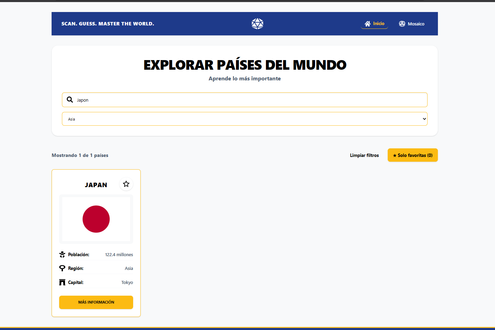
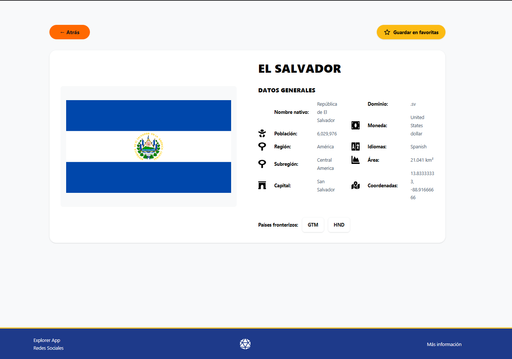
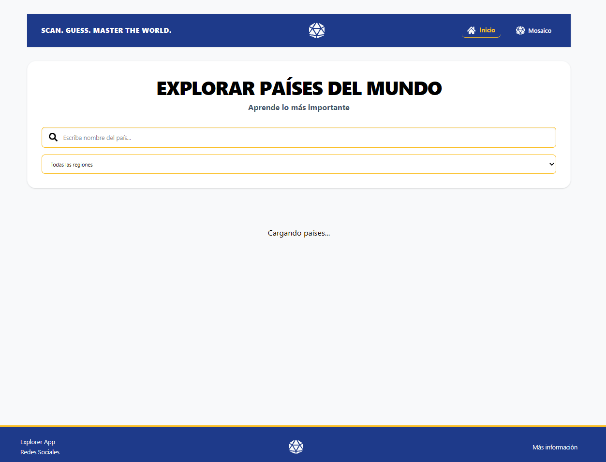
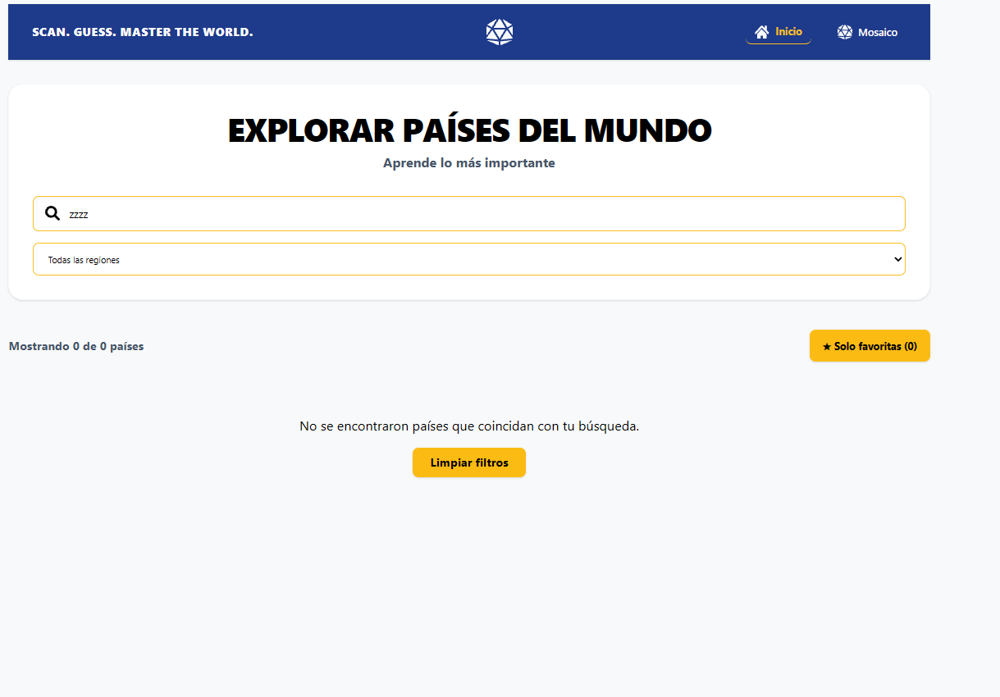
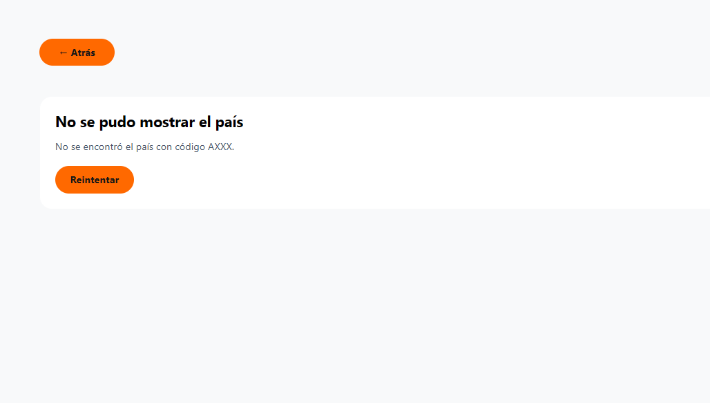

# Explorer App

Aplicación React para explorar países, buscar por nombre, filtrar por región y consultar detalles y fronteras.

- **Demo:** https://explorer-react-alpha.vercel.app/
- **Repositorio:** https://github.com/XavierWrx/explorer-react.git

## Stack

- React 18 y TypeScript (`strict: true`)
- Vite
- Tailwind CSS v4
- React Router v6
- pnpm y oxlint

## Requisitos y ejecución

Se requiere Node.js 22.12 o superior y pnpm.

```bash
git clone https://github.com/XavierWrx/explorer-react.git
cd explorer-react
pnpm install
```

Configura `VITE_REST_COUNTRIES_API_KEY` en el archivo `.env` local. El cliente
usa `/api/countries`: Vite lo reenvía a REST Countries durante el desarrollo y
la función serverless de Vercel lo hace en producción. La clave permanece en
el servidor y no se envía desde el navegador. Configura la misma variable en
los ajustes de entorno de Vercel y no subas `.env` al repositorio.

```bash
pnpm dev
pnpm build
pnpm lint
```

## Funcionalidades

- Catálogo real de REST Countries v5, paginado y con caché compartida en memoria.
- Listado inicial de cuatro países con opción de mostrar cuatro más por bloque.
- Búsqueda con debounce y filtro combinado por región.
- Detalle de país con datos generales y navegación a países fronterizos.
- Estados de carga, error con reintento y resultados vacíos.
- Banderas favoritas persistidas en `localStorage`.
- Diseño adaptable y navegación SPA.

## Estructura y rutas

```text
src/
  api/          cliente y caché de REST Countries
  assets/       iconos e imágenes importados por Vite
  components/   atoms, molecules y organisms
  hooks/        carga, búsqueda y favoritas
  pages/        inicio y detalle del país
  types/        modelos TypeScript
  utils/        formato, filtros y códigos fronterizos
```

- `/`: catálogo, búsqueda y filtros.
- `/country`: estado comprensible cuando falta el código.
- `/country/:code`: detalle del país.

## Capturas

### Listado y detalle
| Listado principal | Detalle del país |
| :--- | :--- |
|  |  |

### Estados de UI
| Estado de carga | Resultados vacíos / Estados UI | Estado de error |
| :--- | :--- | :--- |
|  |  |  |


## Migración de Vanilla TypeScript a React

Se conserva el modelo tipado `Country` y las utilidades de formato y códigos.
La carga de datos se adaptó a REST Countries v5; la interfaz se separó en
componentes y páginas, la lógica de carga y filtros en custom hooks y la
navegación en rutas de React Router.

## Refactor y pendientes

El catálogo real se carga desde un cliente centralizado con paginación y caché;
los SVG se importan como módulos para que Vite los empaquete. Queda agregar las
capturas actualizadas, confirmar los hostnames permitidos en el entorno de
Vercel y medir el rendimiento con Lighthouse. La vista Mosaico sigue pendiente.


## Medición inicial con Lighthouse

- **URL medida:** https://explorer-react-alpha.vercel.app/
- **Fecha:** 23/11/2026
- **Modo:** Móvil 

| Categoría | Puntaje |
| :--- | :--- |
| Performance | 86 / 100 |
| Accessibility |100 / 100 |
| Best Practices | 96 / 100 |

**Interpretación inicial:** 
La aplicación parte con una base sólida en accesibilidad y buenas prácticas. 
Como oportunidades de mejora para la siguiente unidad se identifican el tiempo de renderizado inicial  y la estabilidad visual al cargar las imágenes de banderas. 